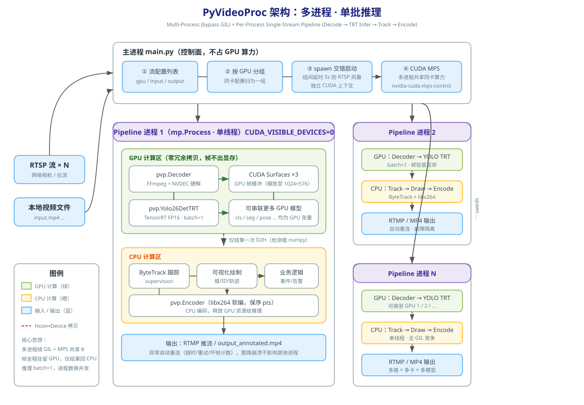

<p style="" align="center">
  
</p>
<h1 align="center">PyVideoProc</h1>
<p style="margin:0px" align="center">
    
    
    
    
</p>

用 Python 在 CUDA  上高效实现多路、多卡、多模型的视频流解码推理跟踪分析，并显著降低开发复杂度

Effortless multi-stream, multi-GPU, multi-model video analytics on CUDA — decode, infer, track, and analyze in pure Python.

[https://github.com/user-attachments/assets/402f9080-004e-457e-8d36-3fefdb56f21d](https://github.com/user-attachments/assets/bb12981c-ac43-40c8-a802-983671356646)

核心特性：

- 多进程 + CUDA MPS 架构，彻底绕过 GIL，CPU 占用极低

- 帧级零拷贝：NVDEC → CUDA Surface → TensorRT 全链路驻留显存，仅检测框结果回传 CPU

- 单批推理（batch=1）保延迟，进程数 × MPS 换吞吐，多路并发近线性扩展

- 多模型 GPU 级联（检测/分类/分割/姿态），中间张量零搬运

- 工业级流媒体健壮性：自动重连 / 超时控制 / B 帧重排 / 抖动缓冲 / 故障隔离

- Docker 一键部署，pt→engine 自动转换并与官方推理结果对齐验证

- 开箱即部署，声明式配置，简单易懂，易于扩展


|                                                           | Open Source |          Learning Curve          |      Developer Friendliness      | Performance |      Architecture Design       |
| :-------------------------------------------------------: | :---------: | :------------------------------: | :------------------------------: | :---------: | :----------------------------: |
| [DeepStream](https://developer.nvidia.com/deepstream-sdk) |      ❌      |               High               |               Low                |    High     | Single-process, multi-threaded |
| [VideoPipe](https://github.com/sherlockchou86/VideoPipe)  |      ✅      | Medium（requires cpp knowledge） | Medium（requires cpp knowledge） |   Medium    | Single-process, multi-threaded |
|                            Our                            |      ✅      |               ≈ 0                |              High 🥰              |   Medium    | Multi-process, single-threaded |

配套视频：

[](https://www.bilibili.com/video/BV12TcvzbEcZ)  [](https://youtu.be/-soVRjH1rb4)

## Quick Start

本项目推荐 Docker 容器运行，首先确保本地环境满足以下三个条件：

- Docker >= 24.0.0
- NVIDIA Driver >= 590
- NVIDIA Container Toolkit >= 1.13.0

### 1. 生成镜像

clone 本项目，生成包含完整开发环境的镜像

```bash
git clone https://github.com/lmk123568/PyVideoProc.git
cd PyVideoProc/docker
docker build -t pyvideoproc:cuda12.8 .
```

镜像生成后，进入容器，不报错即成功

```bash
docker run -it \
  --privileged \
  --gpus all \
  -e NVIDIA_DRIVER_CAPABILITIES=all \
  -v {your_path}/PyVideoProc:/workspace \
  pyvideoproc:cuda12.8 \
  bash
```

后续示例代码默认在容器内`/workspace`运行

> ⚠️ 不推荐自己本地装环境，如果一定要自己装，请参考 Dockerfile

### 2. 编译加速包

```bash
pip install .
# pip install -e .  # 开发模式
```

这里面包含了硬件编解码、YOLO26 推理优化的 C++ 实现，并通过 Pybind11 给 Python 调用

### 3. 训练模型权重转换

将通过 [ultralytics](https://github.com/ultralytics/ultralytics) 训练的`pt`模型导入到当前目录（`/workspace`）下（示例模型为 [yolo26n.pt](https://github.com/ultralytics/assets/releases/download/v8.4.0/yolo26n.pt)）

```bash
python pt2trt.py  --w ./yolo26n.pt --fp16
```

 转换过程中会与 ultralytics 官方结果进行推理对齐

> 💡 TensorRT 编译生成 .engine 过程中，推理尺寸默认设置为`(576,1024)`，可以跳过`letterbox`降低计算开销

> 💡 遇到警告 `requirements: Ultralytics requirement ['onnxruntime-gpu'] not found ...` 可以 `Ctrl + C` 跳过

### 4. 运行

开启 MPS（Multi-Process Service）

```bash
nvidia-cuda-mps-control -d
# echo quit | nvidia-cuda-mps-control  关闭 MPS
```

阅读理解其代码并运行

```bash
python main.py
```

## Benchmark

测试日期: 2026-01-25

测试硬件: AMD Ryzen 9 5950 X + NVIDIA GeForce RTX 3090

测试任务: 4 × RTSP Decoders → YOLO26 (TensorRT) → 4 × RTMP Encoders

|                           | CPU     | RAM     | GPU VRAM | **GPU-Util** |
| ------------------------- | ------- | ------- | -------- | ------------ |
| VideoPipe（ffmpeg codec） | 511.6 % | 1.5 GiB | 2677 MiB | 16 %         |
| Our                       | 40 %    | 1.2GiB  | 3932 MiB | 12 %         |

## Architecture

<p style="margin: 10px 0px" align="center">
  
</p>

多进程单批推理的架构缺点是吃显存，但换来的是天级交付周期、无需专业背景的维护门槛、天然的掉线隔离，以及可预期的故障排查路径

对于摄像头频繁掉线、网络不稳定、团队技术储备有限的现场环境，这个取舍比理论性能更优的方案更合适

🔥🔥🔥 RK3588 版本实现：[PyVideoProc_RK3588](https://github.com/lmk123568/PyVideoProc_RK3588)

## License

[BSD-2-Clause](https://github.com/lmk123568/PyVideoProc/blob/main/LICENSE)
