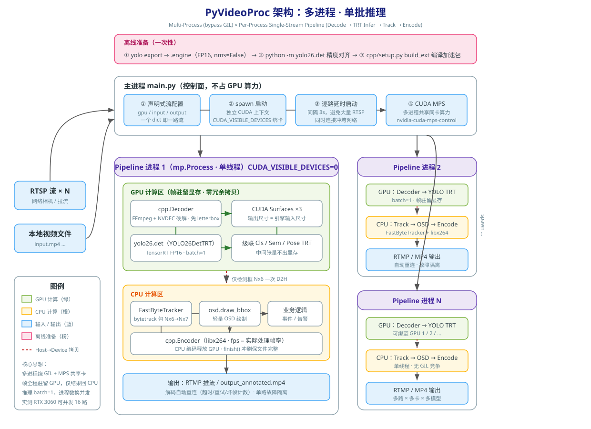

<p style="" align="center">
  
</p>
<h1 align="center">PyVideoProc</h1>
<p style="margin:0px" align="center">
    
    
    
    
</p>


用 Python 在 CUDA  上高效实现多路、多卡、多模型的视频流解码推理跟踪分析，并显著降低开发复杂度

Effortless multi-stream, multi-GPU, multi-model video analytics on CUDA — decode, infer, track, and analyze in pure Python.

RTX 3060 实现 16 路并发：

https://github.com/user-attachments/assets/79d92ff3-3c2d-47eb-8547-294a3b1039c4

支持多任务：

https://github.com/user-attachments/assets/1d028214-bc72-4a95-a834-65e1d4e87324

核心特性：

- 多进程 + CUDA MPS 架构，彻底绕过 GIL，CPU 占用极低

- 帧级零拷贝：NVDEC → CUDA Surface → TensorRT 全链路驻留显存，仅检测框结果回传 CPU

- 单批推理（batch=1）保延迟，进程数 × MPS 换吞吐，多路并发近线性扩展

- 可多模型 GPU 级联（检测/分类/分割/姿态），中间张量零搬运

- 工业级流媒体健壮性：自动重连 / 超时控制 / B 帧重排 / 抖动缓冲 / 故障隔离

- Docker 一键部署，pt -> engine 转换并与官方推理结果对齐验证

- 开箱即部署，声明式配置，简单易懂，易于扩展


|                                                           | Open Source |          Learning Curve          |      Developer Friendliness      | Performance |      Architecture Design       |
| :-------------------------------------------------------: | :---------: | :------------------------------: | :------------------------------: | :---------: | :----------------------------: |
| [DeepStream](https://developer.nvidia.com/deepstream-sdk) |      ❌      |               High               |               Low                |    High     | Single-process, multi-threaded |
| [VideoPipe](https://github.com/sherlockchou86/VideoPipe)  |      ✅      | Medium（requires cpp knowledge） | Medium（requires cpp knowledge） |   Medium    | Single-process, multi-threaded |
|                            Our                            |      ✅      |               ≈ 0                |              High 🥰              |   Medium    | Multi-process, single-threaded |

配套视频（老版）：

[](https://www.bilibili.com/video/BV12TcvzbEcZ)  [](https://youtu.be/-soVRjH1rb4)

## Quick Start

本项目推荐 Docker 容器运行开发，首先确保本地环境满足以下三个条件：

- Docker >= 24.0.0
- NVIDIA Driver >= 590
- NVIDIA Container Toolkit >= 1.13.0

### 1. 生成镜像

Clone 本项目，生成包含完整开发环境的镜像

```bash
git clone https://github.com/lmk123568/PyVideoProc.git
cd PyVideoProc/docker
docker build -t pyvideoproc:cuda12.8 .
```

镜像生成后，进入容器，不报错即成功

```bash
docker run -it \
  --privileged \
  --gpus all \
  -e NVIDIA_DRIVER_CAPABILITIES=all \
  -v {your_path}/PyVideoProc:/workspace \
  pyvideoproc:cuda12.8 \
  bash
```

后续示例代码默认在容器内目录 `/workspace` 运行

> ⚠️ 不建议本地装环境开发（包依赖比较麻烦），如果一定要自己装，请参考 Dockerfile

### 2. 编译加速包

```bash
python cpp/setup.py build_ext --inplace
```

这里面包含了硬件编解码 CPP 实现，并通过 Torch Extension 给 Python 调用

### 3. 模型权重转换

将通过 [ultralytics](https://github.com/ultralytics/ultralytics) 训练的 pt 模型导入到当前目录 `/workspace` 下，以官方 yolo26n.pt 为例

```bash
# 导出 engine 权重
yolo export model=yolo26n.pt format=engine imgsz=512,1024 quantize=16 nms=False
# （可选）测试精度是否对齐
python -m yolo26.det --engine ./yolo26n.engine
```

> 💡 编译生成 engine 时，imgsz 建议设置 (576,1024)，可以跳过 letterbox 降低计算开销，如果是 Jetson 这种边缘设备，imgsz 建议设置 (352, 640)

> 💡 遇到 `requirements: Ultralytics requirement ['onnxruntime-gpu'] not found ...` 可以 `Ctrl+C` 跳过

其它任务支持如下

```bash
# 分类
yolo export model=yolo26n-cls.pt format=engine imgsz=224,224 quantize=16 nms=False
python -m yolo26.cls --engine ./yolo26n-cls.engine
# 语义分割
yolo export model=yolo26n-sem.pt format=engine imgsz=512,1024 quantize=16 nms=False
python -m yolo26.sem --engine ./yolo26n-sem.engine
# 姿态估计
yolo export model=yolo26n-pose.pt format=engine imgsz=512,1024 quantize=16 nms=False
python -m yolo26.pose --engine ./yolo26n-pose.engine
```

### 4. 运行

开启 MPS（Multi-Process Service）

```bash
nvidia-cuda-mps-control -d
# echo quit | nvidia-cuda-mps-control  关闭 MPS
```

⭐⭐⭐ 阅读理解其代码并运行

```bash
python main.py
```

## Benchmark

测试日期: 2026-01-25

测试硬件: AMD Ryzen 9 5950 X + NVIDIA GeForce RTX 3090

测试任务: 4 × RTSP Decoders → YOLO26 (TensorRT) → 4 × RTMP Encoders

|                           | CPU     | RAM     | GPU VRAM | **GPU-Util** |
| ------------------------- | ------- | ------- | -------- | ------------ |
| VideoPipe（ffmpeg codec） | 511.6 % | 1.5 GiB | 2677 MiB | 16 %         |
| Our                       | 40 %    | 1.2GiB  | 3932 MiB | 12 %         |

## Architecture

<p style="margin: 10px 0px" align="center">
  
</p>

多进程单批推理的架构缺点是吃显存，但换来的是天级交付周期、无需专业背景的维护门槛、天然的掉线隔离，以及可预期的故障排查路径。对于摄像头频繁掉线、网络不稳定、团队技术储备有限的现场环境，这个取舍或许理论性能更优的方案更合适

基于本方案架构的实现已在业务场景落地 5000 多路

🔥🔥🔥 RK3588 版本实现：[PyVideoProc_RK3588](https://github.com/lmk123568/PyVideoProc_RK3588)

## License

[BSD-2-Clause](https://github.com/lmk123568/PyVideoProc/blob/main/LICENSE)
